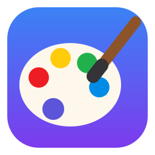
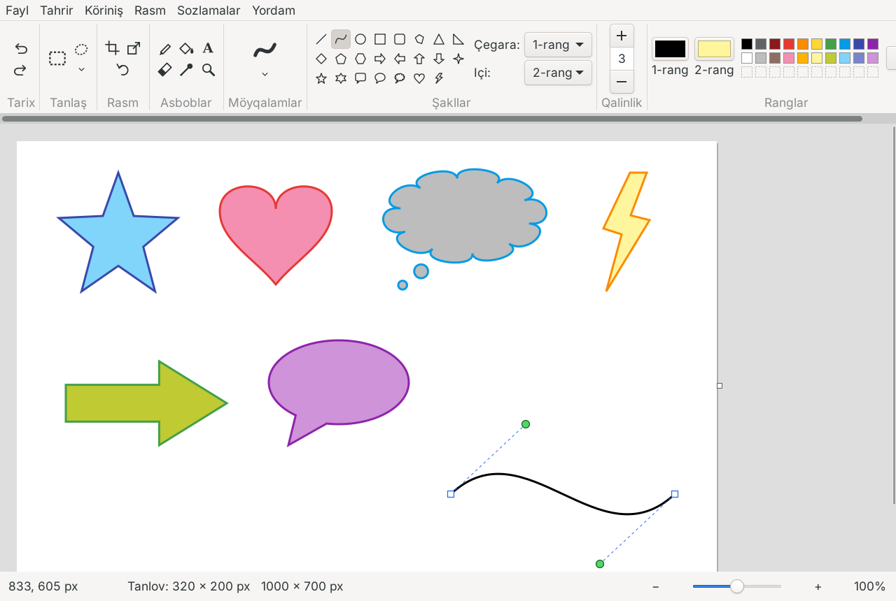

<div align="center">



# Uz Paint

**Linux uçun yengil rasm çiziş dasturi**
**A lightweight drawing program for Linux**

[](https://github.com/nazmiddin255/uz-paint/releases/latest)
[](LICENSE)


[Özbekça](#özbekça) · [English](#english)



</div>

---

## Özbekça

Uz Paint — oddiy va yengil rasm çiziş dasturi. U boşqa dasturlarning kodidan nusxa olmasdan, noldan yozilgan. Dasturning özi **taxminan 180 KB** va **heç qanday qöşimça dastur talab qilmaydi**: Linuxʼda tayyor turadigan GTK3 kutubxonasidan foydalanadi (Node.js, Electron, Python kerak emas).

### Imkoniyatlar

- **Asboblar:** qalam, böyaş (töldiriş), matn, öçirğiç, rang oliş, lupa
- **9 xil möyqalam:** oddiy, kalligrafiya, siyohli pero, purkağiç, moy böyoq, rangli qalam, marker, tabiiy qalam, akvarel
- **23 ta şakl:** çiziq, egri çiziq, oval, törtburçak, yumaloq törtburçak, köpburçak, uçburçak, töğri burçakli uçburçak, romb, beşburçak, oltiburçak, 4 ta strelka, 4/5/6 uçli yulduzlar, 3 xil izoh (gap pufakçasi), yurak, çaqmoq
- **Şakl çizilgandan keyin ham** uni siljitiş, burçaklardan kattalaştiriş, yaşil nuqta bilan buriş, rangini va qalinligini özgartiriş mumkin (Enter yoki Esc — joylaştiriş)
- **Tanlaş:** törtburçak va erkin tanlaş, şaffof tanlaş, siljitiş, buriş, kattalaştiriş, kesiş/nusxa/qöyiş, qirqiş
- **Rasm:** ölçamni özgartiriş (foizda yoki pikselda), qiyşaytiriş, 90°/180° aylantiriş, aks ettiriş, ranglarni teskari qiliş, oq-qora qiliş; kanvas çetidagi kvadratçalarni sudrab ham ölçamni özgartiriş mumkin
- **Köriniş:** kattalaştiriş (12–800%), çizğiçlar, tör çiziqlar, kiçik oyna (miniatyura), töliq ekran
- **Fayllar:** PNG, JPG, BMP, GIF, WEBP, TIFF oçiş; PNG, JPG, BMP, TIFF saqlaş; çop etiş; iş stoli foni qiliş; oxirgi fayllar; faylni oynaga sudrab taşlab oçiş
- **Interfeys:** özbekça (yangi alifbo) va inglizça; yoruğ, qoronği yoki tizimga mos mavzu; interfeys şriftini va ölçamini özgartiriş

### Örnatiş

1. [Releases](https://github.com/nazmiddin255/uz-paint/releases/latest) bölimidan `uz-paint-…-linux-amd64.tar.gz` faylini yuklab oling.
2. Terminalda:

```bash
tar xzf uz-paint-*-linux-amd64.tar.gz
cd uz-paint-*/
./ornatish.sh
```

Parol söralmaydi. Örnatilgandan keyin menyudan **Uz Paint** ni toping.

**Eng oson yöl** — Debian / Ubuntu / Mint uçun `.deb` paket:

```bash
sudo apt install ./uz-paint_*_amd64.deb
```

Öçiriş: `./ochirish.sh` (sozlamalar bilan birga: `./ochirish.sh --hammasi`).

**Talablar:** GTK 3.22+ va glibc 2.34+ (Ubuntu 22.04+, Debian 12+, Linux Mint 21+, Fedora 35+ va boşqalar).

### Manba koddan yiğiş

```bash
sudo apt install build-essential libgtk-3-dev   # Debian/Ubuntu
make
./uz-paint
```

### Litsenziya

[MIT](LICENSE) — bepul işlatiş, özgartiriş va tarqatiş mumkin.

> **Eslatma.** Uz Paint mustaqil loyiha. U Microsoft Corporation bilan boğliq emas va Microsoft tomonidan qöllab-quvvatlanmaydi. Dasturda Microsoftʼning kodi, belgilari (ikonlari), rasmlari yoki boşqa materiallari işlatilmagan — barça belgilar dasturning özida koddan çiziladi. "Microsoft Paint" — Microsoftʼning savdo belgisi.

---

## English

Uz Paint is a simple, lightweight drawing program written from scratch. The program is **about 180 KB** and needs **no extra software**: it uses the GTK3 library that is already present on Linux desktops (no Node.js, Electron or Python).

### Features

- **Tools:** pencil, fill, text, eraser, color picker, magnifier
- **9 brushes:** normal, calligraphy, fountain pen, airbrush, oil, crayon, marker, natural pencil, watercolor
- **23 shapes:** line, curve, oval, rectangle, rounded rectangle, polygon, triangle, right triangle, diamond, pentagon, hexagon, 4 arrows, 4/5/6-point stars, 3 callouts, heart, lightning
- **Shapes stay editable** after drawing: move, resize from the corners, rotate with the green handle, change color and width (Enter or Esc places the shape)
- **Selection:** rectangular and free-form, transparent selection, move, rotate, resize, cut/copy/paste, crop
- **Image:** resize (percent or pixels), skew, rotate 90°/180°, flip, invert colors, black and white; drag the small squares on the canvas edge to resize the canvas
- **View:** zoom (12–800%), rulers, gridlines, thumbnail, full screen
- **Files:** open PNG, JPG, BMP, GIF, WEBP, TIFF; save PNG, JPG, BMP, TIFF; print; set as desktop background; recent files; drag and drop
- **Interface:** Uzbek (new Latin alphabet) and English; light, dark or follow-system theme; adjustable interface font and size

### Installation

Download `uz-paint-…-linux-amd64.tar.gz` from [Releases](https://github.com/nazmiddin255/uz-paint/releases/latest), then:

```bash
tar xzf uz-paint-*-linux-amd64.tar.gz
cd uz-paint-*/
./ornatish.sh
```

Or on Debian/Ubuntu/Mint: `sudo apt install ./uz-paint_*_amd64.deb`

**Requirements:** GTK 3.22+ and glibc 2.34+.

### Building from source

```bash
sudo apt install build-essential libgtk-3-dev
make
./uz-paint
```

### License

[MIT](LICENSE).

> **Disclaimer.** Uz Paint is an independent project. It is not affiliated with, endorsed or sponsored by Microsoft Corporation. It contains no Microsoft code, icons, images or other assets — every icon is drawn in code by the program itself. "Microsoft Paint" is a trademark of Microsoft Corporation.
